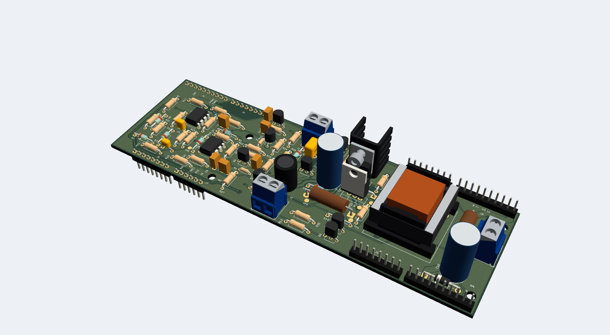
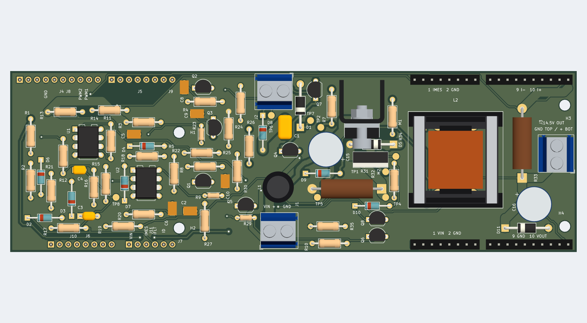
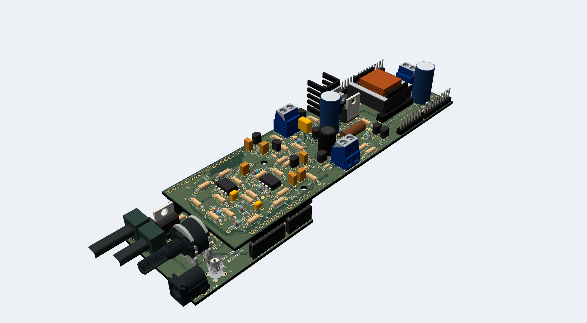
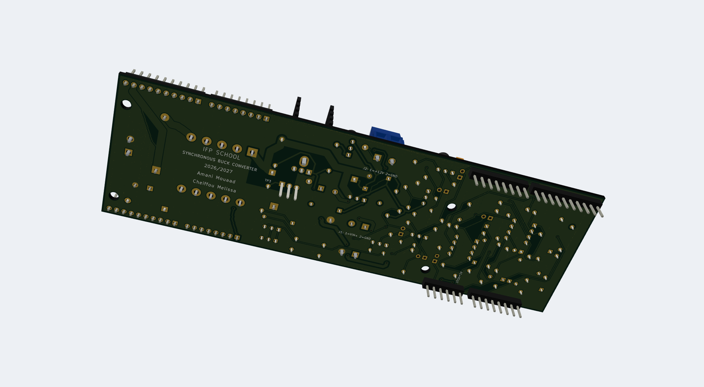
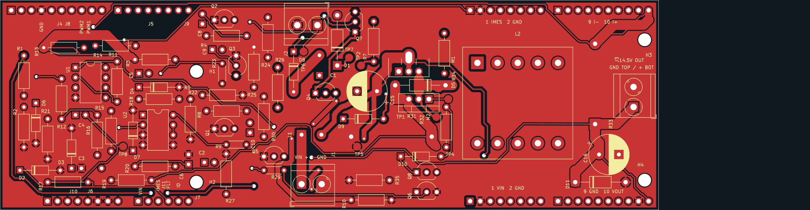
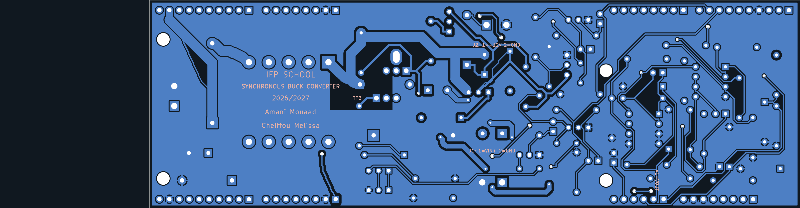
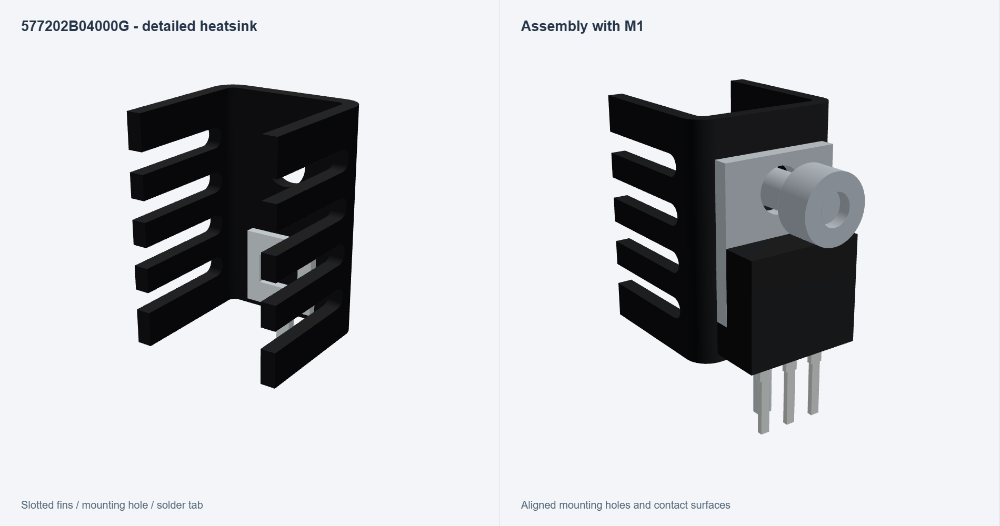
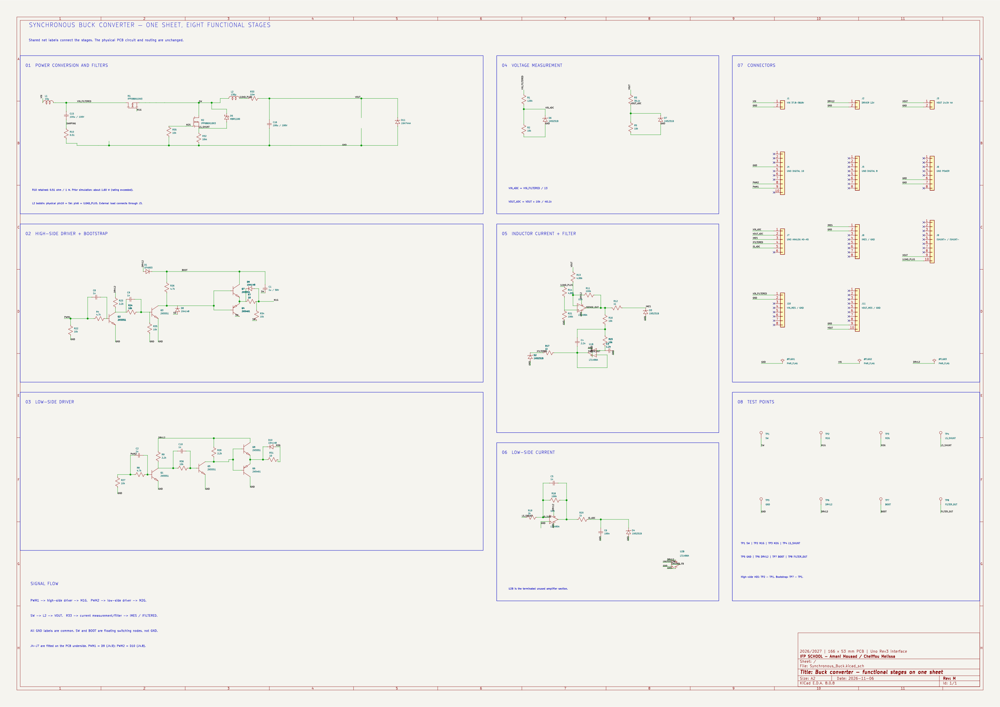

# 58 W Synchronous Buck Converter

**37.8–58.8 V input · 14.5 V / 4 A output target · 100 kHz · Discrete gate drivers**

This project develops a DC–DC buck converter for the auxiliary electrical network of an electric scooter. It steps the traction-battery voltage down to a 14.5 V service supply, with a design power of **58 W**. The work covers the switching stage, discrete transistor gate drivers, current and voltage sensing, LTspice simulation, and a complete two-layer KiCad PCB.

**Project team:** Amani Mouaad and Cheiffou Melissa  
**IFP SCHOOL · Powertrain · 2026/2027**

## Two projects, one conversion system

This power board is the second part of the [analog PWM generator project](https://github.com/MouaadO/analog-pwm-generator). The first board generates two complementary 5 V PWM commands with adjustable dead time. The buck board receives those signals through Arduino Uno Rev3-compatible headers, amplifies them with discrete drivers, and switches the power MOSFETs.

The intended scooter application is the **auxiliary/service electrical network**. The power path and PWM command board form an open-loop demonstrator; the measurement outputs provide an interface for later control development.

## Design targets from the project brief

| Parameter | Target |
|---|---:|
| Converter topology | Non-isolated synchronous buck |
| Battery input range | 37.8–58.8 V DC |
| Output voltage | 14.5 V |
| Maximum output current | 4 A |
| Maximum output power | 58 W |
| Switching frequency | 100 kHz |
| Inductor current ripple | 0.8 A peak to peak |
| Minimum inductance specified in the brief | 137 µH |
| Output voltage ripple target | Below 0.1% of output voltage |
| Measurement interface | 0–5 V analog signals |
| PCB outline | 166 × 53 mm |

These values are the **design specifications**, separate from the LTspice results below. The requirements come from the course mini-project brief, *Conception d’un convertisseur abaisseur de tension à redressement synchrone et de son étage de commande bas niveau*, especially pages 4–5 and 9–12.

At the rated operating point:

$$P_{out}=V_{out}I_{out}=14.5\times4=58\ \mathrm{W}$$

For an ideal buck converter, $D\approx V_{out}/V_{in}$, giving an approximate duty range of **24.7–38.4%** across the specified input range. At 100 kHz, one switching period is **10 µs**. [Design notes](docs/design.md) explain the operating sequence, component roles and sizing equations.

## How the circuit works

1. **Input filtering:** L1 filters the battery input. The 100 µF input capacitor C15 and R10 form the series damping branch used in `Newinputfilter.asc`.
2. **Discrete drivers:** NPN/PNP transistor stages translate the incoming PWM signals into MOSFET gate-drive signals. The high-side stage uses a bootstrap diode and capacitor to create a floating supply referenced to the switching node.
3. **Power conversion:** The high-side MOSFET applies the filtered input to the inductor. The low-side MOSFET provides the synchronous current path during the other part of the cycle. Complementary PWM and dead time come from the first project.
4. **Output smoothing:** The wound E25/13/7 N87 inductor and the output capacitor smooth the switched waveform into a DC output.
5. **Measurements:** Shunts, differential amplifiers, dividers and filters expose input voltage, output voltage, inductor current, filtered current and low-side current signals.

## PCB and mechanical design

The board uses **two copper layers**, predominantly through-hole components, project-local footprints and bundled 3D models. The power section groups the MOSFETs, input capacitor, shunt and output inductor. The driver components sit close to the switching stage, while measurement circuitry occupies the lower-power region.

Main load-current tracks are 2.5 mm wide, with shorter 1.2 mm connections at selected pads. Measurement tracks are 0.3 mm; gate-resistor breakouts use 0.5 mm tracks. Ground fills connect the common return network on both copper layers. A bottom-layer keepout under the switching-node area controls nearby copper placement.

### Top view

### Connection to the PWM board

The underside headers J4–J7 mate with the PWM board. The render illustrates the two-board arrangement; spacer height is an assembly choice.

| Signal | Buck connection | Uno contact |
|---|---|---|
| High-side PWM command | J4 pin 9 | D9 |
| Low-side PWM command | J4 pin 8 | D10 |
| Common ground | J4 pin 4; J6 pins 6–7 | GND |
| Input voltage measurement | J7 pin 1 | A0 |
| Output voltage measurement | J7 pin 2 | A1 |
| Inductor current measurement | J7 pin 3 | A2 |
| Filtered current measurement | J7 pin 4 | A3 |
| Low-side current measurement | J7 pin 5 | A4 |

The power input, 12 V driver supply and output load connect through separate screw terminals. [Connections and assembly](docs/connections.md) provides the complete connector map.

### Underside and stacking contacts

The downward-facing header pins connect the power board to the PWM generator. Project identification is printed on the back silkscreen.

### Front and back routing

| Front copper | Back copper |
|---|---|
|  |  |

### Heatsink and inductor mounting

The high-side MOSFET uses a TO-220 heatsink assembly. The horizontal E25 bobbin anchors the hand-wound inductor to the PCB. Local footprints define the connector positions, bobbin pin pattern and heatsink mounting slot. Manufacturer CAD and drawing-based models are bundled with the project.

## Complete schematic

Open the [KiCad schematic](pcb/Synchronous_Buck.kicad_sch) to inspect the wiring and component values at full resolution.

## LTspice simulation

The included [Newinputfilter.asc](simulation/Newinputfilter.asc) is the circuit used for the current input-filter revision. Its default testbench uses 58.8 V input, a 12 V driver supply, 100 kHz complementary PWM and a 3.625 Ω output load.

The following values are **simulation results**, measured over 6–8 ms in an 8 ms transient run:

| Quantity | Supplied-source model | Model with BOM passive values and capacitor ESR |
|---|---:|---:|
| Average output voltage | 14.504 V | 14.435 V |
| Output voltage ripple | 11.374 mV peak to peak | 69.547 mV peak to peak |
| Inductor current ripple | 0.839 A peak to peak | 0.835 A peak to peak |

Both runs use the supplied source’s active-device models. Simulation logs are included under [docs/results](docs/results). [Simulation instructions](simulation/README.md) identify the main signals to plot.

## Open and explore

1. Clone or download the complete repository.
2. Open [pcb/Synchronous_Buck.kicad_pro](pcb/Synchronous_Buck.kicad_pro) in **KiCad 8 or newer**.
3. Open the schematic or PCB Editor; press **Alt+3** in PCB Editor for the 3D viewer.
4. Keep the `Buck_Footprints.pretty`, `3dmodels`, symbol library and library tables beside the KiCad files.
5. Open `simulation/Newinputfilter.asc` in LTspice for the transient testbench.

The delivered design has **zero ERC violations, zero DRC violations and zero unrouted connections**. The source-to-schematic-to-PCB check covers **159 source-terminal connections**. Fabrication files are available in [pcb/Manufacturing](pcb/Manufacturing) and in the [Gerber/drill ZIP](pcb/Synchronous_Buck_Gerbers_Drills.zip).

## Repository contents

| Folder | Contents |
|---|---|
| `pcb/` | KiCad project, schematic, routed PCB, local libraries, 3D models and fabrication outputs |
| `simulation/` | LTspice schematic and transient simulation guide |
| `bom/` | Original purchasing workbook and current PCB assembly list |
| `docs/images/` | PCB, schematic, heatsink and stacked-board renders |
| `docs/results/` | ERC/DRC reports and LTspice measurement logs |
| `docs/design.md` | Operating principle, equations and PCB design choices |
| `docs/connections.md` | Connector map, test points and mechanical assembly |

**Related project:** [Analog PWM Generator with Adjustable Dead Time](https://github.com/MouaadO/analog-pwm-generator)

### Functional schematic sections

The complete circuit appears on one KiCad schematic sheet, arranged into eight labelled sections: power conversion, high-side driver, low-side driver, voltage measurement, inductor-current measurement and filtering, low-side current, interfaces and test points. [Schematic guide](docs/schematic-stages.md).
